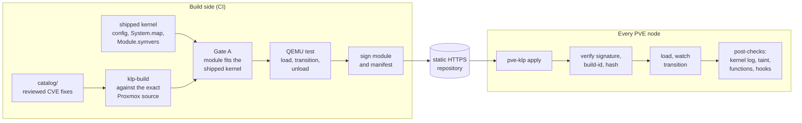

# pve-klp

**Kernel live patching for Proxmox VE 9.** Apply kernel security fixes to
running hosts without a reboot and without your VMs noticing, then reboot at
your next maintenance window instead of tonight.

[](https://github.com/prepaid-host/pve-klp/actions/workflows/ci.yml)
[](LICENSE)


[](https://github.com/prepaid-host/pve-klp/releases)

```console
$ pve-klp status
kernel:        7.3.5-1-pve
ring:          stable
state:         active
livepatch:     klp_pve_7_3_5_1_p3 (level 3)
manifest:      level 3, signed by project, built 2026-11-23 09:00 (0 days ago), expires 2026-12-23
fixed live:    CVE-2026-XXXXX, CVE-2026-YYYYY
NOT covered:   CVE-2026-ZZZZZ (struct change), fixed in 7.3.6-1-pve
reboot:        REQUIRED
               - not fixable by livepatch: CVE-2026-ZZZZZ
```

> **Early release.** The full chain (build from the Proxmox source, Gate A,
> signing, `setup`, `apply`, `revert`, reload after reboot) has run on a real
> `7.3.5-1-pve` kernel in a nested PVE 9.2 VM, with a transition time of about
> 1.6 s. No project builds of livepatch modules are published yet: build your
> own with [docs/self-hosting.md](docs/self-hosting.md). Feedback and testers
> on non-production hosts are very welcome.

## Why

Kernel fixes for Proxmox VE arrive weekly in 2026. Every one means draining a
node, rebooting it and filling it again. Passthrough guests and single nodes
without a migration target have real downtime. Between the fix and the reboot
the host stays vulnerable, and for a guest-to-host escape that is the risk
that matters.

KernelCare covers PVE 7 and 8 only, and Proxmox has livepatching "under
re-evaluation". pve-klp closes the gap with the kernel's own tooling, in the
open, and without making you trust a third party.

## What you get

- **One command to load, one to undo.** `pve-klp apply`, `pve-klp revert`.
- **Honest status.** For every CVE: fixed live, or "reboot required" and in
  which kernel it is fixed.
- **Safe by default.** Signature, kernel build-id and module hash are checked
  before anything is loaded. A stalled transition is reversed, never forced.
  If a new level misbehaves, the previous one comes back automatically.
- **Fits your tooling.** Exit codes, `--json`, Prometheus metrics, hook
  scripts. Ansible decides the order in your fleet; there is no control
  server.
- **Self-hostable.** Run the build pipeline with your own keys and you only
  trust the catalog you review.

## Quick start

On a Proxmox VE 9 host with the opt-in 7.3 kernel:

```bash
# 1. Install the agent (Debian package from the releases page)
wget https://github.com/prepaid-host/pve-klp/releases/latest/download/pve-klp_amd64.deb
apt install ./pve-klp_amd64.deb

# 2. Point it at a repository and its signing key, and check the host
pve-klp setup --repository https://klp.example.org --key https://klp.example.org/manifest.pub

# 3. Load the livepatch for the running kernel
pve-klp apply

# 4. Optional: pick up new levels automatically
pve-klp auto enable
```

Every release ships SHA256SUMS and signed build provenance, so you can check
that a download was built by this repository's CI:

```bash
gh attestation verify pve-klp_amd64.deb --repo prepaid-host/pve-klp
```

A static binary (`pve-klp-x86_64-linux-musl`) is attached to each release as
well, for hosts where you do not want the Debian package.

With Secure Boot, enroll the module certificate once: run `pve-klp mok enroll`
and confirm in MokManager on the next reboot (BMC or local console).

The repository can be the project's (once published) or your own, built with
the pipeline in this repository: see [docs/self-hosting.md](docs/self-hosting.md).

## How it works



- **One cumulative module per kernel.** It contains all fixes and replaces
  its predecessor atomically. At most one livepatch is active per node.
- **Release rings** `canary` → `early` → `stable` are separately signed
  manifests. A maintainer promotes a level explicitly; nothing moves on a
  timer.
- **The build is pinned to the shipped kernel.** The shipped config is
  copied into the tree and compared byte for byte after `make olddefconfig`.
  Any compiler, linker, pahole or rustc difference aborts the build.

Details: [docs/architecture.md](docs/architecture.md).

## Commands

| Command | What it does |
| --- | --- |
| `pve-klp setup` | Set repository, ring and trusted key, then run `check` |
| `pve-klp check` | Kernel config, ftrace, Secure Boot and MOK, keys, repository, tracing conflicts |
| `pve-klp status [--json]` | Active level, fixed CVEs, CVEs that still need a reboot |
| `pve-klp apply [--level N]` | Fetch, verify and load the livepatch for the running kernel |
| `pve-klp revert` | Disable and unload; hold until the next explicit `apply` |
| `pve-klp auto enable\|disable` | Hourly timer for new levels (off by default) |
| `pve-klp mok enroll` | Enroll the module certificate for Secure Boot |

After a reboot into the same kernel, the boot unit reloads the active level
from the local cache before guests start. After a reboot into a new kernel,
nothing old is loaded.

<details>
<summary>Exit codes for monitoring and Ansible</summary>

| `status` | Meaning |
| --- | --- |
| 0 | livepatch active, no known CVE needs a reboot |
| 10 | livepatch active, but a reboot is required |
| 11 | no livepatch active |
| 12 | manifest expired: no further patches are coming |
| 20 | last operation failed, or transition in progress |

| `apply` / `boot` / `revert` | Meaning |
| --- | --- |
| 0 | applied, already active, nothing published, or on hold |
| 2 | failed and backed out |
| 3 | rejected by verification or policy; nothing loaded |
| 4 | precondition failed (transition running, forced leftover, foreign patch) |

Metrics: `/var/lib/prometheus/node-exporter/pve_klp.prom`
(`pve_klp_active_level`, `pve_klp_reboot_required`, `pve_klp_failed`, ...),
written whenever that directory exists (it does once the node_exporter
textfile collector is set up). Set `textfile_dir` to change or `""` to turn
it off.
</details>

## Limits

A livepatch replaces functions, not data structures. These always need a
reboot, and `status` says so:

- changes to data structures, `__init` code, `lib/`, assembler, vDSO;
- out-of-tree modules such as **ZFS**;
- user space such as QEMU or libc (restart or migrate the VM).

Supported: Proxmox VE 9 with the 7.3 kernel series, x86-64. PVE 8 and older
are out of scope.

## Status and roadmap

| | Milestone | State |
| --- | --- | --- |
| 0 | Module from the Proxmox 7.3 tree loads on an unmodified Proxmox kernel | done (nested PVE 9.2, 7.3.5-1-pve) |
| 1 | A real CVE fix as livepatch; review of all 2026 kernel PSAs for livepatchability | planned |
| 2 | Automatic pipeline: newest 3 kernels, Gate A, QEMU test, signing, repository | `builder/run.sh` per kernel done; scheduled CI planned |
| 3 | Agent 0.1: check, status, apply, revert, boot unit, .deb, Ansible role | released in v0.1.0, Ansible role planned |
| 4 | Nested-PVE tests under load, canary on AMD and Intel hardware, 24 h soak | planned |
| 5 | Public project builds, status page, APT repository | planned |

## FAQ

**Does this replace kernel updates?**
No. It moves the reboot into your maintenance window. Install the kernel
update as usual.

**Is it safe?**
The agent never forces a transition and backs out on any sign of trouble.
Still: this is pre-release software that loads code into your hypervisor
kernel. Test on non-production hosts first.

**Why not just KernelCare?**
KernelCare does not support Proxmox VE 9 and has it not on its roadmap.

**Whom do I trust?**
With your own pipeline and keys, only the catalog you review. With project
builds, also the maintainers. See [SECURITY.md](SECURITY.md).

**Does it work with ZFS hosts?**
Yes. Fixes inside the ZFS module itself are not livepatchable and are shown
as "reboot required".

**Why does the kernel show taint `E` after loading?**
Without Secure Boot, the kernel cannot verify the module signature against a
trusted key and marks the kernel with `E`; it loads the module anyway. The
agent verified the signed manifest and the module hash before loading. With
Secure Boot, enroll the module certificate as MOK and the `E` goes away.
Every livepatch also sets `K`, and klp-build modules set `O`.

**Does it affect tracing tools?**
kretprobes on a patched function conflict with livepatches, and kprobes in a
replaced function stop firing. `pve-klp check` warns about active kprobes.

**Is this an official Proxmox project?**
No. It is an independent project and not affiliated with Proxmox Server
Solutions GmbH.

## Documentation

- [Architecture](docs/architecture.md): pipeline, manifest, agent rules
- [Self-hosting](docs/self-hosting.md): your own pipeline and keys, fleet rollout
- [Toolchains](docs/toolchains.md): compiler and snapshot values per kernel release
- [APT repository](docs/apt-repository.md): publishing the agent package
- [Catalog format](catalog/README.md): how CVE entries are written and reviewed
- [Security policy](SECURITY.md)

## Repository layout

| Path | Content |
| --- | --- |
| `crates/pve-klp` | node agent (Rust, single binary) |
| `crates/pve-klp-tool` | build tool: catalog, Gate A, manifests, signing |
| `crates/klp-core` | shared manifest, signature, policy and ELF code |
| `catalog/` | reviewed CVE entries and patches |
| `builder/` | build container and pipeline scripts |
| `packaging/`, `debian/` | systemd units, Debian packaging |

Build: `make test`, `make static` (static musl binary), `make deb`. Rust 1.88+.

## Contributing

Catalog entries, test reports and code are welcome:

- Questions and ideas: [GitHub Discussions](https://github.com/prepaid-host/pve-klp/discussions)
- Bugs and CVE requests: [issues](https://github.com/prepaid-host/pve-klp/issues/new/choose)
- How to contribute: [CONTRIBUTING.md](CONTRIBUTING.md), [Code of Conduct](CODE_OF_CONDUCT.md)
- Vulnerabilities: privately, see [SECURITY.md](SECURITY.md)

## License

GPL-2.0-only, see [LICENSE](LICENSE). Livepatch modules and catalog patches
are derived from the Linux kernel and are GPL-2.0 as well.
