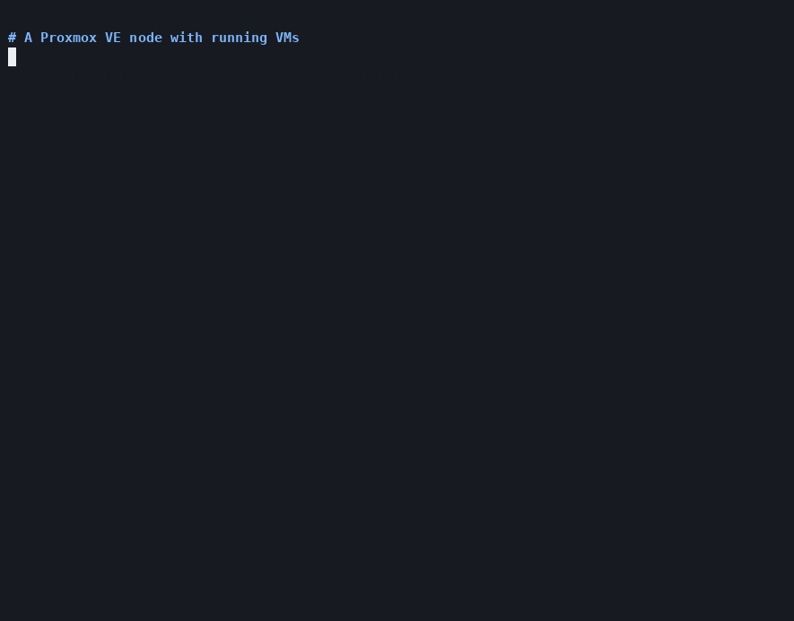

# pve-livepatch-kernel

**Kernel live patching for Proxmox VE hypervisors.** Apply kernel security
fixes to running hosts without a reboot and without your VMs noticing, then
reboot at your next maintenance window instead of tonight.

*This is a fork of [prepaid-host/hvpatch](https://github.com/prepaid-host/hvpatch)
with its full history. On top of it, GitHub Actions builds, signs and tests
the livepatch for every new Proxmox kernel and serves the repository on
GitHub Pages, so a node only runs `hvpatch apply` (see
[Automatic builds](#automatic-builds-on-github-actions)). The agent, the
package and every command keep the name `hvpatch`, so upstream changes merge
cleanly. hvpatch was called pve-klp up to version 0.1.6.*

[](https://github.com/jwklijnsma/pve-livepatch-kernel/actions/workflows/ci.yml)
[](https://github.com/jwklijnsma/pve-livepatch-kernel/actions/workflows/livepatch.yml)
[](LICENSE)


[](https://github.com/jwklijnsma/pve-livepatch-kernel/releases)



*Recorded on a test node with two loaded VMs (`contrib/demo/demo.sh`,
[asciicast](docs/assets/demo.cast)).*

> **Early release.** Tested on real Proxmox VE 9.2 hosts:
>
> - **7.3** (`7.3.4-1-pve`, `7.3.5-1-pve`, nested): the full chain from the
>   Proxmox source to `apply`, `revert` and the reload after reboot; atomic
>   replace between levels; a stalled transition reversed without `force`;
>   Secure Boot with MOK; three backported CVE fixes whose reproducer is
>   vulnerable before, fixed with the livepatch, and vulnerable again after
>   `revert`.
> - **7.0** (`7.0.14-30-pve`, experimental since 0.3.0): a three-node test
>   cluster with loaded guests, no lost guest packet during `apply`
>   ([docs/kernel-7.0.md](docs/kernel-7.0.md)).
>
> This fork publishes its builds at <https://jwklijnsma.github.io/pve-livepatch-kernel>
> (ring `canary` until promoted). Feedback and
> [test reports](https://github.com/jwklijnsma/pve-livepatch-kernel/issues/new?template=test_report.yml)
> from non-production hosts are very welcome.

## Why

Kernel security fixes for Proxmox VE arrive regularly. Every one means
draining a node, rebooting it and filling it again. Passthrough guests and
single nodes without a migration target have real downtime. Between the fix
and the reboot the host stays vulnerable, and for a guest-to-host escape that
is the risk that matters.

As of November 2026, KernelCare does not list Proxmox VE 9 among its
supported platforms, and Proxmox itself offers no livepatching. hvpatch
closes the gap with the kernel's own tooling, in the open, and without
making you trust a third party.

## What you get

- **One command to load, one to undo.** `hvpatch apply`, `hvpatch revert`.
- **Honest status.** For every CVE: fixed live, or "reboot required" and in
  which kernel it is fixed.
- **Safe by default.** Signature, kernel build-id and module hash are checked
  before anything is loaded. A stalled transition is reversed, never forced.
  If a new level misbehaves, the previous one comes back automatically.
- **Learns from failures.** A level that failed or crashed a host is
  quarantined and never loaded again automatically; in a cluster only one
  node loads at a time. A level that misbehaves in the field can be revoked
  centrally: nodes go back to the level before it.
- **Fits your tooling.** Exit codes, `--json`, Prometheus metrics, hook
  scripts. Ansible decides the order in your fleet; there is no control
  server.
- **Self-hostable.** Run the build pipeline with your own keys and you only
  trust the catalog you review.

## Quick start

On a Proxmox VE 9 host with the default 7.0 kernel (experimental) or the
opt-in 7.3 kernel:

```bash
# 1. Install the agent (Debian package from the releases page)
wget https://github.com/jwklijnsma/pve-livepatch-kernel/releases/latest/download/hvpatch_amd64.deb
apt install ./hvpatch_amd64.deb

# 2. Point it at a repository and its signing key, and check the host
hvpatch setup --repository https://jwklijnsma.github.io/pve-livepatch-kernel \
  --key https://jwklijnsma.github.io/pve-livepatch-kernel/manifest.pub --ring canary

# 3. Load the livepatch for the running kernel
hvpatch apply

# 4. Optional: pick up new levels automatically
hvpatch auto enable
```

Every release ships SHA256SUMS, a CycloneDX SBOM (`hvpatch.cdx.json`) and
signed build provenance, so you can check that a download was built by this
repository's CI:

```bash
gh attestation verify hvpatch_amd64.deb --repo jwklijnsma/pve-livepatch-kernel
```

A static binary (`hvpatch-x86_64-linux-musl`) is attached to each release as
well, for hosts where you do not want the Debian package.

With Secure Boot, enroll the module certificate once: run `hvpatch mok enroll`
and confirm in MokManager on the next reboot (BMC or local console).

With Secure Boot, the certificate is at `https://jwklijnsma.github.io/pve-livepatch-kernel/module-cert.der`:
install it as `/etc/hvpatch/module-cert.der` before `mok enroll`.

The repository can be this fork's (GitHub Pages, below) or your own, built
with the pipeline in this repository: see [docs/self-hosting.md](docs/self-hosting.md).

## Automatic builds on GitHub Actions

The [`livepatch`](.github/workflows/livepatch.yml) workflow runs every 6
hours, on changes to `catalog/`, `builder/` or the build tool, and by hand
(Actions → livepatch → Run workflow, optionally with kernel releases and
*force*):

1. It reads Proxmox's package lists (`pve-no-subscription`, `pve-test`) and
   takes the newest 2 releases of each series (7.3 and 7.0).
2. A release that is not in [`builder/kernels.lock`](builder/kernels.lock)
   yet is locked to the commit of Proxmox's release tag on git.proxmox.com,
   committed to `main` (or as a pull request with `LIVEPATCH_LOCK=pr`).
3. A kernel is built when its locked commit, the catalog, the builder or
   the build tool changed since its last publish. `builder/run.sh` runs
   unchanged in the runner: fetch, build (no keys), sign, QEMU test with
   KVM, including the atomic replace of the previous level. One build takes
   a few hours and about 55 GB, which the job makes from the runner's free
   disk.
4. The module goes to ring `canary` of the repository, which lives on the
   branch `klp-repo` and is served on GitHub Pages together with the status
   page, `manifest.pub` and `module-cert.der`. The complete kernel source
   (GPL) is attached to the release `klp-source`.

Promote with Actions → **livepatch-admin** (canary → early → stable), or
revoke a level there. Set `LIVEPATCH_AUTO_PROMOTE=stable` to skip the rings
and serve new builds to every node right away.

**Set up once** (keys, Actions secrets, Pages), on a machine with `gh` and
Rust or a downloaded `hvpatch-tool`:

```bash
builder/ci-setup.sh jwklijnsma/pve-livepatch-kernel        # keys stay in ~/pve-livepatch-keys: back them up
gh workflow run livepatch -R jwklijnsma/pve-livepatch-kernel -f force=true
```

Anyone who can change this repository's workflows can sign modules your
nodes load: keep write access tight. Repository variables for tuning
(series, number of releases, components, QEMU cycles) are listed at the top
of the workflow.

## How it works


- **One cumulative module per kernel.** It contains all fixes and replaces
  its predecessor atomically. At most one livepatch is active per node.
- **Release rings** `canary` → `early` → `stable` are separately signed
  manifests. A maintainer promotes a level explicitly; nothing moves on a
  timer.
- **The build is pinned to the shipped kernel.** The shipped config is
  copied into the tree and compared byte for byte after `make olddefconfig`.
  Any compiler, linker, pahole or rustc difference aborts the build.

Details: [docs/architecture.md](docs/architecture.md).

## Commands

| Command | What it does |
| --- | --- |
| `hvpatch setup` | Set repository, ring and trusted key, then run `check` |
| `hvpatch check` | Kernel config, ftrace, Secure Boot and MOK, keys, repository, tracing conflicts |
| `hvpatch status [--json]` | Active level, fixed CVEs, CVEs that still need a reboot |
| `hvpatch apply [--level N]` | Fetch, verify and load the livepatch for the running kernel |
| `hvpatch revert` | Disable and unload; hold until the next explicit `apply` |
| `hvpatch auto enable\|disable` | Hourly timer for new levels (off by default) |
| `hvpatch mok enroll` | Enroll the module certificate for Secure Boot |

`status` with a fix that needs a reboot (example output):

```console
$ hvpatch status
kernel:        7.3.5-1-pve
ring:          stable
state:         active
livepatch:     klp_hvp_7_3_5_1_p3 (level 3)
manifest:      level 3, signed by repository, built 2026-11-23 09:00 (0 days ago), expires 2026-12-23
fixed live:    CVE-2026-XXXXX, CVE-2026-YYYYY
NOT covered:   CVE-2026-ZZZZZ (struct change), fixed in 7.3.6-1-pve
reboot:        REQUIRED
               - not fixable by livepatch: CVE-2026-ZZZZZ
```

After a reboot into the same kernel, the boot unit reloads the active level
from the local cache before guests start. After a reboot into a new kernel,
nothing old is loaded.

<details>
<summary>Exit codes for monitoring and Ansible</summary>

| `status` | Meaning |
| --- | --- |
| 0 | livepatch active, no known CVE needs a reboot |
| 10 | livepatch active, but a reboot is required |
| 11 | no livepatch active (state `pending` right after a reboot, until the boot unit has reloaded it) |
| 12 | manifest expired: no further patches are coming |
| 20 | last operation failed, or an operation or transition in progress |

| `apply` / `boot` / `revert` | Meaning |
| --- | --- |
| 0 | applied, already active, nothing published, or on hold |
| 2 | failed and backed out |
| 3 | rejected by verification or policy; nothing loaded |
| 4 | precondition failed (transition running, forced leftover, foreign patch) |

systemd shows these codes with LSB names (`status=3/NOTIMPLEMENTED` for a
rejected manifest); only the meanings above apply.

Metrics: `/var/lib/prometheus/node-exporter/hvpatch.prom`
(`hvpatch_active_level`, `hvpatch_reboot_required`, `hvpatch_failed`, ...),
written whenever that directory exists (it does once the node_exporter
textfile collector is set up). Set `textfile_dir` to change or `""` to turn
it off.
</details>

## Limits

A livepatch replaces functions, not data structures. These always need a
reboot, and `status` says so:

- changes to data structures, `__init` code, `lib/`, assembler, vDSO;
- out-of-tree modules such as **ZFS**;
- user space such as QEMU or libc (restart or migrate the VM).

Supported: Proxmox VE 9 with the opt-in 7.3 kernel series, x86-64. The
default 7.0 series is **experimental**: objtool needs backports there, and
7.0.14-30-pve has been built and tested on a three-node test cluster under
guest load ([docs/kernel-7.0.md](docs/kernel-7.0.md)). PVE 8 and older are
out of scope.

## Status and roadmap

| | Milestone | State |
| --- | --- | --- |
| 0 | Module from the Proxmox 7.3 tree loads on an unmodified Proxmox kernel | done (nested PVE 9.2, 7.3.5-1-pve) |
| 1 | A real CVE fix as livepatch; review of all 2026 kernel PSAs for livepatchability | fixes done on 7.3.4-1-pve with reproducer; PSA review open |
| 2 | Automatic pipeline: newest kernels, Gate A, QEMU test, signing, repository | `builder/run.sh` per kernel done; scheduled GitHub Actions pipeline in this fork |
| 3 | Agent: check, status, apply, revert, boot unit, .deb, Ansible role | done (Ansible role and Checkmk check in `contrib/`) |
| 4 | Tests under load, canary on AMD and Intel hardware, 24 h soak | nested tests, stalled transitions, Secure Boot, and a three-node 7.0 cluster with guests under load done; bare-metal canary and 24 h soak open |
| 5 | Public project builds, status page, APT repository | status page generator done (`hvpatch-tool status-page`); public builds and APT repository planned |
| 6 | Default 7.0 kernel series | experimental since 0.3.0 (7.0.14-30-pve); leaves experimental after several releases built and a soak on bare metal |

## FAQ

**Does this replace kernel updates?**
No. It moves the reboot into your maintenance window. Install the kernel
update as usual.

**Is it safe?**
The agent never forces a transition and backs out on any sign of trouble.
Still: this is pre-release software that loads code into your hypervisor
kernel. Test on non-production hosts first.

**Why not just KernelCare?**
As of November 2026, KernelCare does not list Proxmox VE 9 as supported.
Check [TuxCare's FAQ](https://support.tuxcare.com/hc/en-us/sections/4408313341724-FAQ)
for the current state. hvpatch is free, open source, and you sign the
patches with your own keys.

**Whom do I trust?**
With your own pipeline and keys, only the catalog you review. With project
builds, also the maintainers. See [SECURITY.md](SECURITY.md).

**Does it work with ZFS hosts?**
Yes. Fixes inside the ZFS module itself are not livepatchable and are shown
as "reboot required".

**Why does the kernel show taint `E` after loading?**
Without Secure Boot, the kernel cannot verify the module signature against a
trusted key and marks the kernel with `E`; it loads the module anyway. The
agent verified the signed manifest and the module hash before loading. With
Secure Boot, enroll the module certificate as MOK and the `E` goes away.
Every livepatch also sets `K`, and klp-build modules set `O`.

**Does it affect tracing tools?**
kretprobes on a patched function conflict with livepatches, and kprobes in a
replaced function stop firing. `hvpatch check` warns about active kprobes.

**Is this an official Proxmox project?**
No. It is an independent project and not affiliated with Proxmox Server
Solutions GmbH.

## Documentation

- [Architecture](docs/architecture.md): pipeline, manifest, agent rules
- [Self-hosting](docs/self-hosting.md): your own pipeline and keys, fleet rollout
- [Toolchains](docs/toolchains.md): compiler and snapshot values per kernel release
- [APT repository](docs/apt-repository.md): publishing the agent package
- [Catalog format](catalog/README.md): how CVE entries are written and reviewed
- [Writing fixes](docs/writing-fixes.md): callbacks, shadow variables, states
- [Integrations](contrib/README.md): Checkmk, Ansible role and rollout, notification hook
- [Kernel 7.0](docs/kernel-7.0.md): the experimental 7.0 build path
- [Threat model](docs/threat-model.md) and [key management](docs/key-management.md)
- [Security policy](SECURITY.md)

## Repository layout

| Path | Content |
| --- | --- |
| `crates/hvpatch` | node agent (Rust, single binary) |
| `crates/hvpatch-tool` | build tool: catalog, Gate A, manifests, signing |
| `crates/klp-core` | shared manifest, signature, policy and ELF code |
| `catalog/` | reviewed CVE entries and patches |
| `builder/` | build container and pipeline scripts |
| `packaging/`, `debian/` | systemd units, Debian packaging |

Build: `make test`, `make static` (static musl binary), `make deb`. Rust 1.88+.

## Contributing

Catalog entries, test reports and code are welcome:

- Questions and ideas: [GitHub Discussions](https://github.com/jwklijnsma/pve-livepatch-kernel/discussions)
- Bugs and CVE requests: [issues](https://github.com/jwklijnsma/pve-livepatch-kernel/issues/new/choose)
- How to contribute: [CONTRIBUTING.md](CONTRIBUTING.md), [Code of Conduct](CODE_OF_CONDUCT.md)
- Vulnerabilities: privately, see [SECURITY.md](SECURITY.md)

## License

GPL-2.0-only, see [LICENSE](LICENSE). hvpatch is by Christopher Sakel and
contributors ([prepaid-host/hvpatch](https://github.com/prepaid-host/hvpatch));
this fork keeps their copyright and license. Livepatch modules and catalog patches
are derived from the Linux kernel and are GPL-2.0 as well.

Proxmox® is a registered trademark of Proxmox Server Solutions GmbH. hvpatch
is an independent project and is not affiliated with or endorsed by Proxmox
Server Solutions GmbH.
