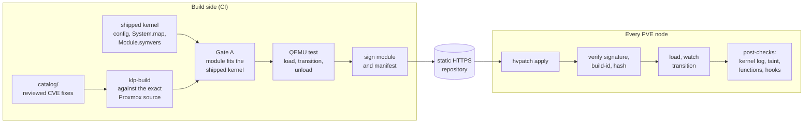

# How it works

- **One cumulative module per kernel.** It contains all fixes and replaces
  its predecessor atomically. At most one livepatch is active per node.
- **Release rings** `canary` → `early` → `stable` are separately signed
  manifests. A maintainer promotes a level explicitly; nothing moves on a
  timer.
- **The build is pinned to the shipped kernel.** The shipped config is
  copied into the tree and compared byte for byte after `make olddefconfig`.
  Any compiler, linker, pahole or rustc difference aborts the build.

Details: [docs/architecture.md](architecture.md).
