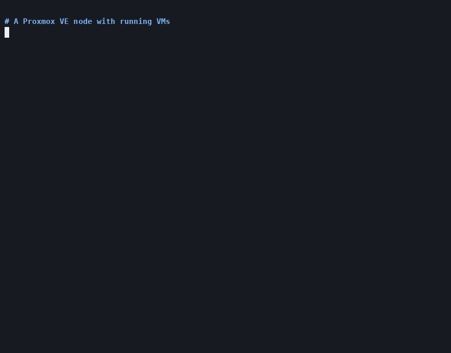

# pve-livepatch-kernel

**Kernel live patching for Proxmox VE hypervisors.** Apply kernel security fixes to running
hosts without a reboot and without your VMs noticing, then reboot at your next maintenance
window instead of tonight.

-   :material-rocket-launch: **[Quick start](quickstart.md)**

    Install `hvpatch`, run `hvpatch apply`.

-   :material-github: **[Automatic builds](automatic-builds.md)**

    GitHub Actions builds, signs and tests a livepatch for every new Proxmox kernel.

-   :material-sitemap: **[Architecture](architecture.md)**

    Pipeline, manifest and the agent's rules.

-   :material-shield-lock: **[Threat model](threat-model.md)**

    What is trusted, what is checked, and the keys behind it.

## What you get

| | |
|---|---|
| **One command to load, one to undo** | `hvpatch apply`, `hvpatch revert` |
| **Honest status** | Per CVE: fixed live, or "reboot required" and in which kernel it is fixed |
| **Safe by default** | Signature, kernel build-id and module hash checked before loading; stalled transitions reversed, never forced |
| **Learns from failures** | Failed levels are quarantined; one node at a time in a cluster; central revocation |
| **Fits your tooling** | Exit codes, `--json`, Prometheus metrics, hook scripts, Ansible rollout |
| **Self-hostable** | Your own pipeline and keys, trusting only the catalog you review |

!!! note "Fork of hvpatch"
    This is a fork of [prepaid-host/hvpatch](https://github.com/prepaid-host/hvpatch) with its
    full history. The agent, the package and every command keep the name `hvpatch`.
